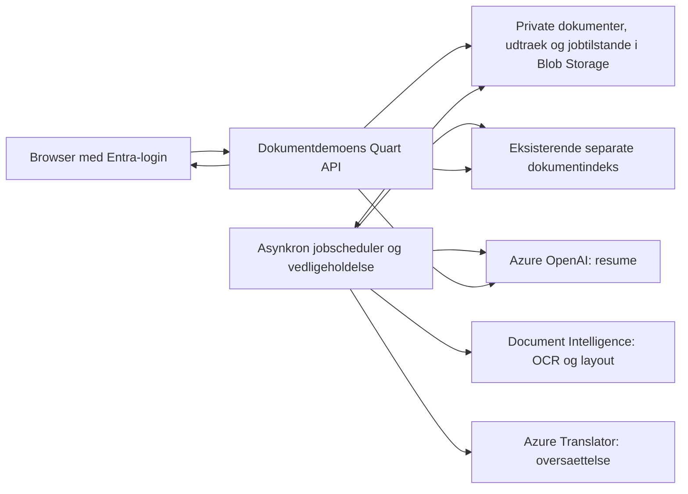
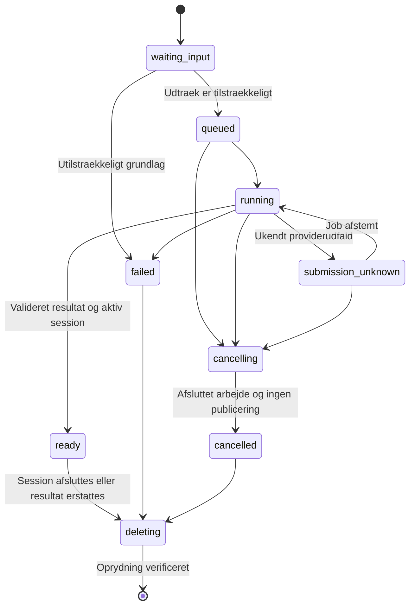

# SRD: Dokumentoversættelse og resumé i Alm. Brand-demoen

**Version:** 0.7, 27. oktober 2026.  
**Status:** Koden er deployeret til dokumentappen med Translator konfigureret; oversættelse og resumé er ikke aktiveret, og budgetregnskabet er ikke godkendt.  
**Produktgrundlag:** [PRD og godkendte produktvalg](document_translation_prd.md).  
**Eksisterende løsning:** [Privat dokumentdemo](document_chat_demo.md).

## Implementeringscheckpoint, 27. oktober 2026

- Frontend understøttes som desktopbrowser på en pc. Mobiltilpasning er ikke
  et acceptkrav. Azure-backend og eksisterende isolation er uændret.
- Lokal kode findes nu for privat fuldt tekstudtræk, konservativ dækningskontrol,
  varige jobs, resumé over hele tekstgrundlaget, originalkilder, rigtig DOCX,
  Translator-adapter, ejerbaseret logout og desktopkontroller.
- `DOCUMENTCHAT_ENABLE_ARTIFACTS` er som standard `false`. Nye jobs kræver
  aktivering. `DOCUMENTCHAT_TRANSLATOR_SERVICE` er navnet på en regional
  Translator-resource, ikke en vilkårlig URL eller nøgle. Adapteren bruger
  Entra-token. Appens managed identity har nu verificeret læseadgang til
  Translator og staging fra den deployerede proces; skriveadgang og komplette
  artefaktjobs fra appen er fortsat ikke live-verificeret.
- Translator-staging kræver private containere med navnene
  `ab-documentchat-translation-source` og `ab-documentchat-translation-target`
  i dokument-Storage. De er nu oprettet med privat adgang. Den endeligt testede
  Translator-identitet har Blob Data Contributor på netop de to containere,
  ikke på dokumenternes originale container eller hele kontoen.
- En varig reservation i `coordination/paid-artifact.json` begrænser samtidig
  betalt artefaktbehandling. Polling bruger ikke den lange kørselslås.
  Afbrudt/ukendt indsendelse bliver ikke automatisk genindsendt. Hvis automatisk
  afstemning ikke finder provider-ID'et, beholdes reservation og oprydningspost;
  næste job kan derfor kræve operatørafklaring. Det er ikke en garanti om
  præcis én fakturering hos provideren.
- Runtime-artefakter kræver nu også et særskilt, godkendt månedsregnskab i
  `coordination/artifact-budget.json`. Hvert modelkald og hver oversættelse
  reserveres varigt før betalt arbejde. Manglende/ugyldigt regnskab, udløbet
  måned, lagerfejl eller utilstrækkeligt råderum blokerer kaldet. Ingen
  reservation frigives automatisk ved fejl, annullering eller ukendt udfald.
  Se afsnit 9.2 om dækning og åbne økonomiske gates. Intet regnskab er oprettet
  eller godkendt i Azure i denne fase.
- Afstemning gennemløber nu paging på både Translator-joblisten og dens
  dokumentlister. Fortsættelsesparametre bevares, API-versionen fastholdes,
  og links skal være HTTPS på samme resource og samme listesti. Cykler,
  ugyldige svar og mere end 100 sider pr. liste afvises uden ny submission.
- Oprydningsposter ligger uden for dokumentets sletbare prefix under
  `translation-operations/`. De bevares, indtil providerens slutstatus og
  staging-oprydning er bekræftet. Bevar Translator-konfiguration og worker under
  rollback; slå nye bestillinger fra med featureflaget, ikke ved at fjerne
  oprydningskoden eller identitetens nødvendige adgang.
- Dækningspolitikken afviser bl.a. manglende PDF-sider, utilstrækkelig OCR-sikkerhed,
  flersidetabeller og DOCX-billeder uden verificeret tekstgrundlag. Tærsklerne er
  konservative prototyperegler, ikke en valideret kvalitetsgaranti. Chat er separat.
- Seneste lokale verifikation: 102 backendtests og 9 browsertests, nyt
  frontend-build, `ty check` og Ruff består. HTTP/providerkald i tests er mockede.
  Deployment-scriptet beskytter nu også code-only mod originalappen, har
  60 sekunders credential-timeout og understøtter eksplicit målrettet genstart.
  Den udvidede readiness-kontrol kan verificere Translator- og staging-læsning
  fra den nye appproces uden at starte betalte jobs.
  En ARM-læsning bekræftede eksisterende Document Intelligence som S0 i West Europe.
- Den efterfølgende livefase er dokumenteret nedenfor. T1–T7 er ikke samlet
  lukket: repræsentative PDF/scan til dansk DOCX, OCR/sprog, modelkvalitet,
  reelle leases/provider recovery, B1-kapacitet, Entra/sletning og målt pris.
  De resterende afsnit er designgrundlaget fra version 0.1, ikke dokumentation
  for at alle kontrakter og releasegates allerede er opfyldt.

## Appinstallation, 27. oktober 2026

Brugeren bekræftede fungerende login og bad om at fortsætte installationen.
Kun den separate dokumentapp er kodeopdateret; der er ikke genprovisioneret,
ændret Entra-login, tildelt nye roller eller ændret originalapp/lagerretention.

- Kudu-deployment: `88047980-8f7e-4653-b1ad-9d7d30f10115`, status 4,
  `complete=true`, `active=true`.
- Aktiv `X-DocumentChat-Build`: `3eba3924f9624215a627bbc80661d256`, efter
  målrettet genstart. Readiness og login-krav er verificeret på denne markør.
- Indstillinger: `DOCUMENTCHAT_TRANSLATOR_SERVICE=cog-trdoc-b32vfnrzdibxy` og
  `DOCUMENTCHAT_ENABLE_ARTIFACTS=false`. Alle øvrige tidligere indstillinger
  blev sammenlignet og bevaret, uden udskrift af hemmeligheder.
- `/healthz?artifacts=1`: HTTP 200 fra denne build med `translator_access=true`,
  `staging_access=true`, `budget_approved=false`, `enabled=false`.
  Kontrollen læser containerproperties og Translator-joblisten, ikke dokumenter,
  og starter ingen oversættelses-, OCR- eller modeljobs.
- Budgetregnskabet er ikke oprettet/nulstillet. Ingen betalte tests eller jobs er
  startet i installationsfasen. T7, Word-rendering og øvrige åbne livegates er
  ikke lukket ved denne installation. Upload/chat kan fortsat testes; de nye
  tilvalg er skjult, indtil aktivering er forsvarlig.
- `--status-only` på deploymentscriptet kan aflæse Kudu-status og runtime-proben
  uden upload/genstart. Ekstra statustest består; alle 111 lokale tests består.

## Live-verifikation, 27. oktober 2026

En isoleret Translator `cog-trdoc-b32vfnrzdibxy` er oprettet som regional
`TextTranslation`, S1, i Sweden Central med systemtildelt identitet,
custom subdomain og `disableLocalAuth=true`. Entra-bearer gav HTTP 200;
der blev ikke brugt nøgler, SAS, offentlige blobs eller kundedokumenter.
Se [Translator-template](../infra/document-chat-translator.bicep) og
[parameterfil](../infra/document-chat-translator.bicepparam).

Den [genkørbare kontrol](../scripts/verify_document_translation.py) anvendte
den eksisterende OCR-parser, dækningskontrol, varige operationer og Translator-adapter.
Den afsluttende kørsel gav:

| Syntetisk input | Udtrukne sider | Resultat | Providerens fakturerede tegn |
| --- | --- | --- | --- |
| Engelsk DOCX med simpel tabel | 1 logisk DOCX-side | Dansk DOCX, tabel og værdi 42 bevaret | 575 |
| Tysk tekst-PDF | 2 | Dansk DOCX med begyndelse og slutning | 504 |
| Engelsk scannet PDF uden tekstlag | 2 | OCR og dansk DOCX med begyndelse og slutning | 458 |

Alle tre providerjobs sluttede `Succeeded`, med `total=1`, `success=1` og
`failed=0`. Begge staging-containere blev også uafhængigt kontrolleret tomme
efter oprydning. De tre midlertidige testbrugerroller og den overflødige
kilde-læserrolle er fjernet; runtime-rollerne er bevaret.

Første forsøg gav `InvalidDocumentAccessLevel` og nul fakturerede tegn.
Efter justering af kildecontainerens rolle lykkedes oversættelsen. Et andet
forsøg afslørede, at Office-tabeller uden sideregioner blev fladet ud før
oversættelse. Parseren bruger nu tekstspændene som fallback; regressionstesten
og den afsluttende livekørsel bekræfter tabelbevarelse.

Samlet rapporterede provideren **2.112 fakturerede tegn**, inklusive det
oversatte fejlforsøg før tabelrettelsen: **0,03168 USD** ved den offentlige
S1-listepris på 15 USD pr. million tegn. OCR og Storage kommer separat.
Dette er providerforbrug og et listeprisestimat, ikke en afstemt Azure-faktura.
Den oprindelige lokale tegnberegning undervurderede providerens tæller; scriptet
bruger nu `totalCharacterCharged` ved prisberegning. Ingen commitment-plan er valgt.

Lokale syntetiske input, DOCX-resultater og JSON-rapporter ligger i
`.venv/documentchat-live/`, uden for versionsstyring. Scriptet har
`--prepare-only`, et loft på 10.000 kildetegn og eksplicit
`--resume-operation` uden automatisk genindsendelse. Genkørsel kræver midlertidig
testadgang via `DOCUMENTCHAT_TEST_OPERATOR_ID`; fjern rollerne eksplicit bagefter.
En tom parameter sletter ikke tidligere roller i et inkrementelt ARM-deployment.

App-kode og app-indstillinger er ikke ændret i Azure. `DOCUMENTCHAT_ENABLE_ARTIFACTS`
og `DOCUMENTCHAT_TRANSLATOR_SERVICE` er fortsat fraværende. Live-smoketesten
er ikke en godkendelse af lange eller repræsentative dokumenter, resuméets
live-modelkvalitet, automatisk sprogvalg, provider recovery/late writes,
120-minutters sletning, fem samtidige brugere, app-identitetens adgang eller
det samlede 25-dokumenters månedsbudget. Disse gates er stadig åbne.

## Godkendte eksempel-filer, 27. oktober 2026

Efter brugerens godkendelse er tre engelske PDF'er kørt gennem den eksisterende
Azure OCR-parser, dækningskontrol, Translator og Azure OpenAI. Originalerne er
kun læst. Dokumentindhold, modeltekst og filnavne er ikke lagt i versionsstyring.
De endelige resultater er samlet lokalt uden for repository og inputmappen i
`C:\Temp\DocumentChat-test-results\review-ready-20261027`.

| Godkendt input | Sider | Oversættelse | Endeligt dansk resumé | Fakturerede Translator-tegn |
| --- | --- | --- | --- | --- |
| Engelsk tekst-PDF | 4 | Læsbar DOCX | 488 ord, originalkilder side 1–4 | 26.105 |
| Samme PDF uden tekstlag | 4 | OCR og læsbar DOCX | 463 ord, originalkilder side 1–4 | 26.109 |
| Anden engelsk tekst-PDF | 6 | Læsbar DOCX | 433 ord, originalkilder side 1–6 | 30.226 |

Alle tre Translator-jobs sluttede `Succeeded`, med ét vellykket dokument og
ingen fejlede dokumenter. Providerens samlede tæller er **82.440 tegn**, svarende
til **1,2366 USD** ved S1-listeprisen. OCR og alle resuméforsøg kommer separat;
der er ikke foretaget fakturaafstemning eller fuld månedsbudgetverifikation.
Begge staging-containere er efterfølgende uafhængigt verificeret tomme,
inklusive operationsjournaler. Ingen nye ressourcer eller roller blev oprettet
i denne fase; eksisterende nedarvede testbrugerrettigheder var tilstrækkelige.

De første resuméforsøg blev korrekt afvist, fordi modellen brugte ID'er uden
for det aktuelle delafsnit. En promptændring alene var ikke stabil nok.
Modellen får nu strukturerede tekstkilder og et strengt JSON-schema med en
enumeration af netop de tilladte kilde-ID'er for hvert trin. Serveren validerer
afsnit og ID'er og indsætter selv de numeriske henvisninger. Mellemnoter bevarer
flere detaljer, så slutresuméet kan nå den aftalte længde uden fyld. Alle dele
indgår stadig i behandlingen; ukendte eller andre delafsnits ID'er afvises.

De tre endelige resuméer krævede hver tre modelkald, samlet 29.618 inputtokens
og 8.511 outputtokens. Disse tal omfatter kun de endelige resuméer, ikke de
tidligere diagnoseforsøg. En kontrol med DOCX-biblioteket bekræftede, at de
kanoniske JSON-resuméer, tekstfiler og DOCX har samme resuméindhold, og at DOCX
indeholder læsbare originale sidehenvisninger. Brugeren har efter gennemgang
godkendt kvaliteten af disse tre PDF-eksemplers resultater. Det er en konkret
eksempelgodkendelse, ikke en generel garanti for faglig korrekthed eller
godkendelse af endnu uprøvede dokumenttyper og størrelser.

To danske DOCX-filer blev lokalt blokeret af den eksisterende regel om
ikke-verificerede indlejrede billeder. Ingen dansk-til-dansk-oversættelse blev
bestilt. En efterfølgende lokal pakkekontrol fandt EMF/VML-grafik i den ene
Word-fil og 23 JPEG/PNG-billeder i den anden. Parseren verificerer ikke disse
billeder; blokeringen bevares, indtil der er en testet billed-/renderingsvej.
En PDF på cirka 40,9 MiB blev blokeret før cloudkald af grænsen på
20 MiB. Ingen grænser eller kvalitetskontroller blev omgået. Der var ingen
tyske brugerfiler; den tidligere syntetiske tyske prøve er fortsat eneste
tyske live-evidens.

Kontrolscriptets `--input-folder` kræver eksplicit `--approved-documents` og
`--openai-service`, begrænser udtrækket til 100.000 tegn og holder resultater
uden for Git og originalmappen. Denne testtilstand bruger brugerens oplyste
sprogkonvention: dansk DOCX og engelsk PDF, ikke automatisk sproggenkendelse.
`--summary-from` genbruger ét gemt udtræk til en eksplicit modelgenkørsel uden
ny OCR eller oversættelse. Lokale QA-filer følger ikke appens sessionslevetid.

Appen er ikke deployeret eller aktiveret: begge artefaktindstillinger er
fortsat fraværende. Live app-identitet, session/udløb, provider recovery,
kapacitet, lange dokumenter, DOCX-billedhåndtering og samlet budget er stadig
åbne gates. De godkendte eksempler lukker ikke T1–T7 samlet.

## Efterfølgende driftskontrol, 27. oktober 2026

Tretten nye mockede regressioner dækker tabt svar efter provideraccept,
genoprettelse af adapteren fra den varige journal, match på senere sider i
både job- og dokumentlisten, fortsættelsestokens, usikre paging-links, cykler
og sidegrænsen. De kontrollerer også, at ukendt udfald eller afstemningsfejl
bevarer journal og reservation uden genindsendelse eller publicering. En
afsluttet session under afhentning af færdigt provideroutput forhindrer
publicering og efterlader ikke det kendte terminale stagingresultat.

Et Entra-autentificeret live-læsekald til den eksisterende Translator med
API-version `2026-03-01` gav HTTP 200 og otte eksisterende jobs. Provideren
returnerede ingen fortsættelsesside; fler-side-forløbet er derfor dokumenteret
med mocks, ikke som et fuldt live paging-/crash-bevis. Kaldet bestilte ingen
oversættelser. Ingen nye ressourcer, roller, app-indstillinger eller deployment
blev ændret i denne fase. T4/T6 er endnu ikke samlet bestået live.

## 1. Formål og beslutningsstatus

SRD'en beskriver softwarekrav, løsningsarkitektur, kontrakter og verifikation
for udvidelse af den separate Alm. Brand-demo med oversættelse og resumé.
Den oprindelige RAG-demo må ikke erstattes eller ændres af denne leverance.

**SKAL** angiver et krav. **Foreslået** angiver et teknisk valg, der skal
reviewes og eventuelt justeres efter den tekniske prøve. **Afklaring T1–T7**
angiver forhold, som ikke er verificeret og ikke må omtales som fungerende.
PRD'ens afklarede produktvalg er styrende ved uoverensstemmelser.

Dette dokument giver ikke i sig selv tilladelse til installation eller ændring
af fælles compute, identiteter eller retention. Den aftalte økonomiske betingelse
gælder fortsat: intet særskilt prisoverslag eller ny økonomisk godkendelse er
nødvendig, når begrænsede indledende tests underbygger et forventet månedligt
merforbrug under 1.000 DKK. Tests tæller med i budgetrammen. Ingen tests eller
Azure-ændringer er udført som led i udarbejdelsen af denne SRD.

## 2. Godkendt scope

| Område | Bindende produktkrav |
| --- | --- |
| Input | DOCX, tekst-PDF og maskintrykt scannet PDF; dansk, engelsk og tysk |
| Grænser | 20 MiB, 100 PDF-sider, 200.000 DOCX-teksttegn samt eksisterende ZIP- og chunkbeskyttelse |
| Oversættelse | Kun dansk; læsbar DOCX som resultat også ved PDF-input; kun download |
| Resumé | Altid dansk, generelt overblik på cirka 400–600 ord, kortere ved korte dokumenter |
| Resumélevering | Visning med klikbare originalkilder og DOCX-download med samme tekst og læsbar kildefortegnelse |
| Start | To uafhængige, som standard fravalgte checkboxes ved upload samt knapper efter upload |
| Chat | Fortsat baseret på originalen; hverken resumé eller oversættelse erstatter chatindekset |
| Privatliv | Én aktiv original pr. bruger, samme eksisterende loginberettigelse og servervaliderede ejer |
| Levetid | 120 minutters inaktivitet; Nyt dokument, Afslut demo og appens eksplicitte Log ud lukker adgangen |
| OCR-fejl | Ved konstateret utilstrækkeligt grundlag stoppes den berørte funktion; ingen delvise resultater |
| Drift | Genbrug først; nye komponenter kræver dokumenteret behov og plads i budgettet |
| Belastning | 1–5 samtidige brugere; færre end 25 dokumenter pr. måned samlet, ikke pr. bruger |
| Økonomi | Højst 1.000 DKK i månedligt merforbrug ud over eksisterende demo |
| Ventetid | Fem minutter er ønskemål, også for store dokumenter; længere ventetid accepteres med reel status |
| Data og kvalitet | Kun godkendte, ikke-følsomme demodokumenter; brugeren leverer eksempler og vurderer resultater |

Samme grænse gælder ved upload fra browser og API. Dansk-til-dansk-oversættelse
skal undgås; danske dokumenter kan fortsat få resumé. Funktionen er ikke en
generel PDF-til-Word-konvertering af allerede danske dokumenter.

## 3. Eksisterende arkitektur og nødvendige ændringer

Følgende er observeret i den lokale kode, ikke en ny live-inventering:

- [web.py](../app/backend/documentchat/web.py) har separat Quart-app, token- og
  Origin-kontrol, upload, session, chat, originaldownload og `/api/end`.
- [store.py](../app/backend/documentchat/store.py) har ejermanifest, dokumenttilstand,
  originalfil og fornyede Blob-leases. Udskiftning aktiverer et nyt dokument-ID.
- [service.py](../app/backend/documentchat/service.py) parser originalen og
  indekserer chunks. Det fulde tekstudtræk gemmes ikke som et selvstændigt,
  genbrugeligt artefakt i det observerede ingest-forløb.
- Den nuværende worker gennemløber dokumenter sekventielt og bruger samme
  vedligeholdelsesforløb til ingestion og oprydning. Lang behandling kan forsinke oprydning.
- Eksisterende dokumentlås holdes under ingestion. Nye langvarige oversættelses-
  og resuméjobs må ikke blot tilføjes under samme lange dokumentlås.

**Foreslået retning:** Bevar React/Quart og eksisterende dedikerede dokument-Storage,
Search-indeks, OCR og modelintegration. Tilføj genbrugeligt tekstudtræk og en
varig jobmodel i Blob Storage. Start med en asynkron jobscheduler i dokumentappens
proces, ikke en ny hostingplatform. Appens genstart skal være ufarlig for jobstatus.
En separat worker eller kø vurderes kun, hvis målinger viser behov.

## 4. Løsningsarkitektur



Diagrammet viser den foreslåede udvidelse. Scheduler og nye artefakter er ikke
implementeret. Browseren får ikke providercredentials eller direkte Blob-adgang.
Chat bruger fortsat Search og modellen som i dag; resumé henter hele tekstgrundlaget
fra dokumentets udtræk, ikke chattens top-k søgeresultater.

### 4.1 Fælles tekstudtræk og kvalitetskontrol

1. Upload valideres, originalen gemmes uændret, og valg gemmes varigt inden
   aktivering af dokumentmanifestet. Bekræftet upload må ikke miste de valgte jobs ved genstart.
2. Udtræk udføres på originalen og får en versionsidentitet. OCR genbruges
   mellem ingestion og resumé, hvor muligt; providerkrav kan kræve separat PDF-behandling.
3. Udtrækket registrerer dokumentrækkefølge, tekstafsnit, kildeankre og kendte
   mangler. PDF-ankre er originale sider; DOCX-ankre er tekstafsnit, ikke trykte sidetal.
4. Kvalitetskontrol vurderer blandt andet forventet/udtrukket sideantal,
   tekstmængde pr. side, ekstraktionsfejl og tilgængelige OCR-signaler.
   En legitim blank side skal ikke automatisk tælle som OCR-fejl.
5. Ved konstateret utilstrækkeligt grundlag får den berørte funktion `failed`
   med `insufficient_text`, og brugeren bedes levere et bedre dokument.

Foreslået kildesprogsvalg er `auto`, `da`, `en` eller `de`, med manuel rettelse.
Ukendt/ikke-understøttet sprog må ikke stiltiende oversættes som engelsk.
Dokumenter med blandede sprog eller usikker registrering kræver en konkret,
testet håndteringsregel; de er ikke lovet automatisk fuld understøttelse (T2).
Falsk eller mangelfuld OCR kan ikke forventes opdaget i alle tilfælde.

#### Næste tekniske prøve: Word-filer med billeder

En kandidat er en isoleret headless Word-til-PDF-renderer i Azure, efterfulgt
af den eksisterende PDF/OCR-vej. En etableret renderer som LibreOffice skal
afprøves på både EMF/VML og rasterbilleder; endnu en ren Word-tekstparser er
ikke tilstrækkelig. Kandidaten er ikke implementeret eller provisioneret.
Der tilføjes ikke en tung renderer til den fælles B1 uden kapacitetsbevis.

Prøven skal bevare originalen, verificere synlige tekst-/billedmarkører og
tabeller og holde kildehenvisninger knyttet til originaldokumentet. Rendering
alene beviser ikke, at grafik eller billedtekst er korrekt gengivet. Dækning
må ikke markeres tilstrækkelig ved blot at fjerne billedafvisningen.

En eventuel worker skal have isoleret midlertidigt filområde, deaktiverede
makroer, ingen automatiske eksterne dokumentopslag, afgrænset CPU/hukommelse
og køretid samt mindst mulig identitetsadgang til privat staging. Ingen
vilkårlige bruger-URL'er eller providercredentials i browseren. Varig
jobkorrelation, annullering, udløb og oprydning skal omfatte også konverteringen.
Eksisterende uploadgrænser, budget og originaldemoens retention bevares.
Faste og variable konverteringsomkostninger skal indgå i T7 før aktivering.

### 4.2 Oversættelse

- DOCX: foreslået asynkron Azure Translator Document Translation til dansk DOCX.
- PDF: den tekniske prøve skal verificere en understøttet vej til dansk DOCX (T1).
  Første kandidat er providerunderstøttet PDF-til-DOCX-output, hvis tilgængeligt
  for den valgte API. Alternativ kandidat er struktureret OCR/layout til DOCX
  med et etableret bibliotek, efterfulgt af Translator på denne DOCX.
- Alternativet må ikke godkendes alene ud fra, at en fil kan åbnes: afsnit,
  tabellers sammenhæng og tekstindhold skal kontrolleres. En PDF får aldrig
  blot en `.docx`-endelse. En betalt konverteringstjeneste er ikke forudsat.
- Output SKAL valideres som en gyldig, læsbar DOCX før `ready`. Der må ikke
  leveres PDF eller rent tekstoutput som skjult erstatning for det godkendte format.
- Kildesprog og valgt API/version registreres på jobbet. Målsprog fastsættes
  til `da` på serveren. Allerede dansk input giver `not_needed`, uden betalt
  dansk-til-dansk-oversættelse og med en forståelig besked.

API-version og PDF-metode fastlåses først efter prøven. Den aktuelle PRD
refererer til `2026-03-01` GA; denne SRD har ikke verificeret PDF-til-DOCX live.
T1 er en releaseblokering, ikke en begrundelse for at udskyde PDF fra første release.

### 4.3 Resumé og kilder

- Foreslået genbrug af eksisterende Azure OpenAI-model; kontekstgrænse,
  tokenbudget, kvalitet og kapacitet verificeres i T3.
- Alt udtrukket indhold skal indgå i behandlingsgrundlaget. Ved opdeling
  udarbejdes mellemresuméer i dokumentrækkefølge med kildeankre, efterfulgt af
  en samlet syntese. Tavs afkortning til de første sider er ikke tilladt.
- Resuméet beskriver formål, hovedpointer og konklusioner, når disse faktisk
  findes. Dokumenttekst er ukendt input og må ikke ændre systeminstruktioner.
  Ingen eksterne opslag, værktøjshandlinger eller selvstændig rådgivning.
- Centrale udsagn knyttes til eksisterende kilde-ID'er fra originalens udtræk.
  Serveren validerer referencer og afviser ukendte kilder. Syntaktisk gyldige
  referencer er ikke en garanti for faktisk støtte; dette testes med review.
- Gem ét kanonisk resumé med kildefortegnelse. Visning og DOCX bygges fra samme
  version uden ny modelgenerering ved download. DOCX indeholder forståelige
  sidetal/afsnitsreferencer og uddrag, ikke hemmelige links eller krav om aktiv session.
- Der vises ikke et tidligt delresumé som færdigt resultat. Konstateret manglende
  dækning stopper publicering. Korte dokumenter må give under 400 ord uden fyld.

## 5. Data- og lagringsmodel

Eksisterende `sessions/{owner}.json` og `documents/{owner}/{document_id}/`
bevares som koncept. Følgende er foreslåede nye private artefakter:

| Artefakt | Indhold og autoritet |
| --- | --- |
| Dokumenttilstand | Originalhash, udtræksversion, kildeformat, kildesprog, kvalitetsstatus og aktive jobreferencer |
| `extraction.json` | Ordnet fuldt tekstudtræk, kilde-ID'er, PDF-sider/DOCX-afsnit og dækningsmetadata |
| `jobs/{job_id}/state.json` | Ejer, dokument-ID, type, status, revision, anmodningsfingerprint, timestamps, forsøg, provider-ID, næste poll, annulleringsønske, sikre fejlkoder |
| `jobs/{job_id}/summary.json` | Kanonisk resumétekst, kildehenvisninger, model-/promptversion og udtræksversion |
| `jobs/{job_id}/result.docx` | Valideret oversættelse eller resumé; kun aktiv resultatpointer gør filen downloadbar |
| Translator-staging | Separate private kilde-/målcontainere og unikt prefix pr. job, hvis krævet af valgt API |
| Oprydningsrecord | Minimale referencer til kendte jobs/prefixes og resterende oprydning; ingen dokumenttekst |
| Forbrugsregnskab | Aggregerede driftsmålinger/reservationer uden dokumenttekst eller fulde filnavne |

Ejer kommer alene fra valideret `tid`/`oid`, aldrig fra klienten. Dokument-ID
og job-ID er servergenererede UUID'er. Inputhash/fingerprint er ikke adgangstilladelse
eller en mekanisme til at dele/cache indhold på tværs af brugere.
Udtræk, mellemresuméer og DOCX-filer følger originalens levetid. Aggregerede
driftsmålinger og minimale oprydningsmetadata kan leve længere uden indhold.
TTL for disse metadata fastlægges i T6, ikke som en skjult dokumentretention.

## 6. Jobtilstande, låsning og genstart



Terminalen `not_needed` gælder dansk-til-dansk-oversættelse og vises uden
resultatfil. Annullering/udløb fra `waiting_input` håndteres også; diagrammet
viser hovedforløbet, ikke en tilladelse til at springe livscykluskontrol over.
UI viser typebestemte danske labels. Ingen opdigtet procent eller sluttid.

- **J1:** Nye API-kald accepterer en idempotensnøgle. Samme ejer/dokument,
  handling, nøgle og input giver samme logiske job; ændret input med samme
  nøgle giver `409`. Også identiske samtidige startforsøg uden fælles nøgle
  skal afstemmes mod det eksisterende aktive job af samme type.
- **J2:** Claim af arbejde sker med fornyet lease på jobrecord; tab af lease
  stopper lokale writes/publicering. In-memory tasks alene er ikke jobregister.
- **J3:** Langvarig providerbehandling holder ikke sessionens eller dokumentets
  fælles lås. Resultater skrives privat som kandidater og publiceres først,
  når aktivt dokument, resultatgeneration og lease er kontrolleret igen.
- **J4:** Publicering og manifestændring serialiseres med korte låse/versionstjek.
  Implementeringen skal dokumentere låserækkefølgen; ingen rutine må vente
  på en lang joblease, mens en session-/dokumentlås holdes. Eksisterende
  uploadlåserækkefølge må ikke ændres uden samtidighedstests.
- **J5:** Gem provider-ID og næste handling varigt. Efter genstart afstemmes
  eksisterende providerjobs før ny submission; HTTP-fejl er ikke bevis for,
  at et Azure-job aldrig blev startet.
- **J6:** Ekstern exactly-once-betaling må ikke loves uden providerstøtte.
  Ukendt submission markeres `submission_unknown` og må ikke genindsendes
  blindt. Mulighed for entydig afstemning/korrelation skal verificeres i T4.
- **J7:** Foreslået højst tre lokale forsøg for retrybare fejl med backoff,
  jitter og `Retry-After`. Permanente inputfejl gentages ikke. Genforsøg
  efter et afsluttet fejljob er eksplicit og får egen sporbar revision.

## 7. Foreslåede API-kontrakter

Eksisterende `/api/session`, `/api/upload`, `/api/end`, `/api/activity`,
`/api/chat` og originaldownload bevares kompatible. Nedenstående nye kontrakter
er ikke implementeret. Alle private routes anvender samme token-, ejer-,
Origin- og no-store-kontrol som eksisterende API.

| Metode og route | Kontrakt |
| --- | --- |
| `POST /api/upload` | Eksisterende multipart `file`; foreslåede valg `translation_requested`, `summary_requested` og `source_language`. Manglende valg er false/auto. Valg gemmes varigt; svar fortsat `202`. |
| `POST /api/document/{id}/jobs` | JSON med `kind: translation|summary`, `source_language: auto|da|en|de`, valgfrit `target_language` som kun må være `da`; header `Idempotency-Key`. `202` for accepteret job; `200` for allerede færdigt genbrugt resultat. |
| `GET /api/document/{id}/jobs` | Kun dette aktive dokuments jobstatus, sikre fejl og downloadmuligheder; ingen interne Blob-adresser eller providercredentials. |
| `GET /api/document/{id}/jobs/{job_id}` | Status, type, timestamps, retrymulighed og resultatversion; poll er ikke aktivitet. |
| `GET /api/document/{id}/jobs/{job_id}/summary` | Kanonisk tekst og validerede kilder til UI; kun resumé i `ready`. Kildeobjekter har originalside/afsnit og tekstuddrag til modal. |
| `GET /api/document/{id}/jobs/{job_id}/download` | Valideret DOCX med sikkert filnavn, korrekt MIME og `Content-Disposition: attachment`. Kun aktiv resultatversion. |
| `POST /api/document/{id}/jobs/{job_id}/cancel` | Idempotent annulleringsønske. Fjerner resultatadgang; afventer ikke lang providerannullering i HTTP-kaldet. |
| `POST /api/document/{id}/jobs/{job_id}/retry` | Kun fejl/annullerede jobs med tilladt retry; ny sporbar revision, idempotens og budgetkontrol. Færdige resultater regenereres ikke ved almindelig download. |
| `POST /api/logout` | Lukker ejerens aktuelle serversession, også hvis klientens dokument-ID er gammelt. Idempotent. Derefter går browseren til den faste Easy Auth-logoutadresse. |

Klienten kan ikke vælge ejer, container, blobsti, modeldeployment eller vilkårlig
callback. Multipart-booleans og JSON-felter valideres eksplicit; en streng
`"false"` må ikke fortolkes som sand. Ingen UI-default er en sikkerhedsgrænse.

Nye routes bør have sikre fejlkoder som `session_expired`, `document_replaced`,
`insufficient_text`, `unsupported_language`, `job_not_ready`, `provider_unavailable`
og `budget_blocked`, med dansk besked, retryflag og korrelations-ID.
Brug `400` ved ugyldig kontrakt, `401` ved manglende login, `404` ved ukendt/fremmed
job uden ejerskabsafsløring, `409` ved versions-/tilstandskonflikt, `413` ved størrelse,
`429` ved kvote og `503` ved midlertidig utilgængelighed. Eksisterende routes'
fejlformat ændres ikke stiltiende. Klienten håndterer stadig tomme/non-JSON platformfejl.

## 8. Sikkerhed, udløb og oprydning

- **SEC1:** Bevar eksisterende Entra-validering og Origin-kontrol. Managed
  identity foretrækkes til tjenester og Storage. Ingen nye secrets i klienten,
  offentlige blobs, direkte bruger-SAS eller udvidet brugerberettigelse.
- **SEC2:** Ejer, aktivt dokument og jobrelation kontrolleres ved hver læsning,
  status, kildevisning, annullering og download samt før publicering/svar.
  Job-ID eller kendskab til blobnavn giver ikke adgang.
- **SEC3:** Brug upload, spørgsmål, eksplicit jobstart og godkendte UI-handlinger
  som aktivitet under eksisterende throttling. Polling, model-/Translatorarbejde
  og blot at lade fanen stå åben forlænger ikke de 120 minutter.
- **SEC4:** Logout kalder serverafslutning før Easy Auth-redirect. Ved fejl må UI
  ikke påstå, at dokumentsession og sletning er bekræftet. Eksternt Entra-logout
  eller browserlukning kan ikke forventes altid at give en app-notifikation.
- **SEC5:** Nyt dokument/afslutning/udløb invalidérer manifest/resultatpointere
  straks; providerannullering og fysisk oprydning er efterfølgende arbejde.
  Allerede leverede downloads eller bytes kan ikke tilbagekaldes.
- **SEC6:** Sæt annulleringsønske og bevar minimal oprydningsrecord. Afvent/afstem
  kendte providerjobs, og rens alle originale, udtrukne, mellem- og resultatfiler,
  stagingprefixes og Search-chunks. Genkontrollér efter terminal providerstatus,
  så sene writes ikke bliver liggende. Delvis fejl skal være retrybar.
- **SEC7:** En record fjernes ikke som afsluttet oprydning, mens et job med ukendt
  udfald fortsat kan skrive. Det kan kræve længere levetid for indholdsfri
  metadata, men giver aldrig fortsat brugeradgang. T4/T6 skal verificere dette.
- **SEC8:** Oprydning og polling skal kunne køre, mens et andet job venter på
  provider. Den nuværende sekventielle worker må ikke blot få lange ekstra jobs
  indsat foran alle oprydningsopgaver. Ingen fysisk sletnings-SLA loves ved udfald.
- **SEC9:** Modeloutput rendres sikkert uden scripts/aktiv HTML. Dokumenttekst
  kan ikke instruere modellen til at hente URLs eller vise andre brugeres data.
- **SEC10:** Logs indeholder kun sikre IDs, fejlkategori, timing og tællere.
  Ingen dokumenttekst, prompts, resuméer, tokens, SAS, fulde filnavne eller cookies.

Translator skal bruge private, dedikerede kilde-/målområder med dokumenteret
mindsteprivilegium. Serviceidentiteters eventuelle container-/indeksadgang er
ikke brugerisolering i sig selv. Originaldemoens Storage og retention ændres ikke.
Providerens midlertidige lagring/sletning beskrives særskilt; appens sletning er
ikke en garanti om alle providerinterne systemer eller administratoradgang.

Eksisterende GlobalStandard-model er ikke EU-only. Europæisk Translator-region
giver ikke en samlet EU-only-garanti for OCR, resumé og chat. Kun aftalte
ikke-følsomme data må anvendes; regioner og faktiske begrænsninger dokumenteres.

## 9. Kapacitet, økonomi og observation

**Krav til servicevalg:** Free-/F0-tiers er ikke et mål i sig selv. For hver
valgt tjeneste registreres SKU, API/modelversion og relevante begrænsninger
for sider, filstørrelse, indhold, funktioner, throughput og throttling.
Free må kun vælges, hvis hele det aftalte input og kravene til kvalitet og
svartid kan understøttes. Ellers vælges en egnet betalt tier inden for budgettet.
Ingen skjult afkortning, færre OCR-sider eller lavere kvalitetskrav accepteres
for at passe ind i en gratisversion. Betalt kapacitet må ikke forveksles med
automatisk bedre model-/OCR-kvalitet; begge dele verificeres i T1–T3/T5.
T7 skal medregne den faktisk nødvendige tier, også dens faste omkostninger.
Kan en egnet løsning ikke holdes under 1.000 DKK i månedligt merforbrug,
afklares ændret budget/scope med brugeren før øget forbrug eller kvalitetsreduktion.

Foreslået pilotkonfiguration: ét aktivt betalt baggrundsjob ad gangen i hele
dokumentappens deployment og højst ét job af hver type pr. bruger/dokument.
Poll/annullering/oprydning må ikke optage denne betalte jobplads. Global begrænsning
skal håndhæves med varig koordinering/leases, ikke kun en per-proces semaphore.
Chat må ikke vente på en fælles langtidsjoblås. Fem samtidige brugere betyder
ikke fem samtidige providerjobs. Fair kø mellem ejere og eventuel øget samtidighed
afprøves i T5; køstatus skal skelnes fra aktiv behandling.

Foreslåede sikkerhedsgrænser er tre retrybare forsøg og 30 minutters jobdeadline
inklusive kø. Disse er ikke godkendte ydelsesløfter. Deadline giver annulleringsønske
og sikker fejl, ikke påstand om, at providerarbejde/betaling er ophørt.
Daglige startkvoter og endelige token-/outputgrænser fastlægges efter T3/T5/T7;
25 dokumenter er beregningsramme, ikke en vedtaget uploadkvote.

Forbrugsvurderingen SKAL omfatte 25 dokumenter med begge tilvalg samt normale
chat-/OCR-/embeddingmeromkostninger, retries, Storage, netværk og eventuelle
faste ekstra ressourcer. Registrér dokumentstørrelser/sidetal, OCR-behov,
input-/outputtokens, betalte operationer, anvendte priser/valutabasis og margin.
Vis både repræsentativt scenarie og større dokumenters følsomhed; få korte
tekstfiler er ikke bevis for økonomien ved store scannede PDF'er.

Foreslået forbrugskontrol reserverer en konservativ jobomkostning før betalt
arbejde og afstemmer faktisk/estimeret forbrug efterfølgende. Nye betalte jobs
blokeres, hvis registreret forbrug plus reservationer overskrider rammen eller
grundlaget ikke længere er troværdigt. Ratecards og reservationslofter verificeres
i T7. Azure-budgetalarmer og forsinkede usage-data er ikke et hårdt fakturaloft;
100 % garanti for en maksimumsfaktura må ikke loves. Ved udsigt til overskridelse
stoppes nye tests/jobs, og ændrede rammer aftales frem for skjult opskalering.

Driftsmålinger: kø-/behandlingstid pr. type, udfald, retries, ukendte submissions,
forbrug, joblease-tab, udtræksdækning, OCR-afvisninger og oprydningsrestancer.
Alarmer/deaktivering skal kunne reagere på fastlåst oprydning og uafstemt forbrug.
Ingen dokumenttekst i metrics, tracing eller fejlrapporter.

### 9.1 Foreløbigt prisgrundlag og følsomhed, 27. oktober 2026

[Azure Retail Prices API](https://prices.azure.com/api/retail/prices) gav
følgende DKK-listepriser for de eksisterende tjenester. Modelberegningen bruger
almindelig GlobalStandard, ikke batch-, priority- eller cache-rabatter:

| Måler | Region | Pris |
| --- | --- | --- |
| `5.4 mini Inp Gl 1M Tokens` | Sweden Central | 4,9338 DKK pr. million inputtokens |
| `5.4 mini Opt Gl 1M Tokens` | Sweden Central | 29,6028 DKK pr. million outputtokens |
| `S0 Pre-built Pages`, layout/præbyggede modeller | West Europe | 65,784 DKK pr. 1.000 sider |

Modelmålerne var gældende fra 1. marts 2026, OCR-måleren fra 1. august 2021.
[Translator S1-prissiden](https://azure.microsoft.com/en-us/pricing/details/cognitive-services/translator/)
angiver 15 USD pr. million dokumenttegn. Omregningen her bruger en udtrykkelig
planlægningskurs på 7 DKK/USD, ikke en verificeret fakturakurs.
[OCR-prissiden](https://azure.microsoft.com/en-us/pricing/details/ai-document-intelligence/)
bekræfter S0-prisfamilien; Read- og add-on-målere bruges ikke som layoutpris.

Grundlaget er de tre endelige prøvers 82.440 fakturerede Translator-tegn,
14 OCR-sider og 29.618/8.511 input-/outputtokens. Første række skalerer disse
målinger til 25 dokumenter. Anden række antager 100 sider og 300.000
fakturerede tegn pr. dokument; modeldelen er en konservativ lineær
tegnskalering af prøverne, ikke en målt 100-siders kørsel.

| Månedsscenarie, 25 dokumenter med begge tilvalg | Oversættelse | OCR | Resumé | Delsum | Med 50 % buffer og 100 DKK øvrig reserve |
| --- | --- | --- | --- | --- | --- |
| Som de afprøvede PDF'er | 72,14 | 7,67 | 3,32 | 83,13 DKK | 224,69 DKK |
| 100 sider og 300.000 fakturerede tegn hver | 787,50 | 164,46 | 36,22 | 988,18 DKK | 1.582,26 DKK |

Reserven på 100 DKK er en foreløbig planlægningspost for chat, embeddings,
Search/Storage/netværk og testforbrug, ikke måling eller dokumenteret øvre
grænse. Tidligere mislykkede resuméforsøg er ikke fuldt tokenafstemt. Ingen
konverteringsworker, faste nye ressourcer eller moms er indregnet. Den
eksisterende B1-plan er ikke opskaleret; et eventuelt kapacitetsbehov kommer
oven i denne beregning. T7 er derfor fortsat åben.

Små eksempler understøtter et lavt forventet merforbrug, men store dokumenter
kan overskride 1.000 DKK. Aktivering kræver afklaret samlet prisgrundlag og
forbrugsreservation/stop af nye betalte jobs ved utilstrækkeligt råderum.
Grænser, kvalitet eller budget ændres ikke stiltiende for at få scenariet til
at passe. Overslaget er hverken en faktura eller et hårdt faktureringsloft.

### 9.2 Lokal stopkontrol for runtime-artefakter

[Budgetkomponenten](../app/backend/documentchat/budget.py) bruger den eksisterende
Blob-lease med fornyelse. Læsning, kontrol og skrivning af en reservation sker
under samme lås på tværs af workers og ejere. Providerkaldet starter først efter
bekræftet skrivning. Regnskabet ligger uden for dokumentets sletbare prefix og
indeholder kun tilfældige reservations-ID'er, formål og beløb, ikke ejere,
filnavne eller dokumenttekst. Logout eller dokumentoprydning må ikke nulstille det.

Skemaeksempel, **ikke** en godkendelse af det viste råderum:

```json
{
  "version": 1,
  "month": "2026-10",
  "rate_card": "documentchat-2026-10-v1",
  "limit_ore": 100000,
  "overhead_ore": 20000,
  "reservations": {}
}
```

Beløb gemmes som heltalsøre. `limit_ore` må ikke overstige 100.000; `overhead_ore`
reserverer en eksplicit vurderet del til øvrige udgifter og allerede udførte
tests. De 200 DKK i eksemplet er ikke en målt eller anbefalet grænse.
Nye reservationer afvises, når overhead plus eksisterende og ønsket reservation
overskrider grænsen. Låsfejl og lagerfejl stopper også inden providerkald.

Det lokale ratecard tillader kun deploymentnavnet `gpt-5.4-mini`. Hvert modelkald
reserverer 400.000 inputtokens og 3.500 outputtokens til priserne fra 9.1,
to gange prismargen og faktor 1,25 for moms, afrundet op: **5,20 DKK pr. kald**.
Det gælder hvert map-, reduce- og sluttrin samt automatisk sprogbestemmelse.
Modellens faktiske navn/version og inputloft skal bekræftes før aktivering;
deploymentnavnet alene er ikke bevis for disse egenskaber. Eksplicit dansk
oversættelse afsluttes uden betalt sprogbestemmelse eller oversættelsesreserve.

Translator-estimatet bruger to gange tekstens UTF-16-længde plus 10.000 tegn,
105 DKK pr. million tegn (15 USD ved kurs 7), samme prismargen og momsfaktor.
Dette er en konservativ planlægningsregel, **ikke** et dokumenteret øvre loft
for providerens `totalCharacterCharged`. Oversættelsesjournalen gemmer det
tilhørende reservations-ID før POST. Ingen af reservationerne frigives eller
nedskrives automatisk, heller ikke ved afvist kald, forkert modeloutput,
annullering, timeout, procesafbrydelse eller efterfølgende vellykket oprydning.
Et resumé med opbrugt budget undervejs fejler uden delvist resultat.

Operatøren skal før aktivering afstemme allerede udførte tests og øvrigt
merforbrug, verificere ratecard/valuta/moms og oprette regnskabet med godkendt
råderum. Der er intet offentligt API til godkendelse eller nulstilling, og
ingen automatisk månedsrulning. Før ny måned skal gamle poster arkiveres og
uafklarede operationer vurderes og reserveres videre, også hvis de kan blive
faktureret i den nye måned. Sletning/nulstilling for at genstarte en blokeret
kø er ikke en tilladt genvej.

**Resterende T7-arbejde:** Kontrollen dækker runtime-kald gennem `ArtifactJobs`,
ikke selvstændige verifikationsscripts, OCR, chat, embeddings, Search, Storage,
netværk eller en fremtidig konverteringsworker. Disse udgifter skal omfattes
af overhead/afstemning og senere samlet stopkontrol. Faktisk forbrug nedskriver
endnu ikke reservationer; sikkerhedsreglen kan derfor stoppe før budgettet reelt
er brugt. Tests med syntetiske svar dækker delte reservationer, manglende eller
ugyldig godkendelse, opbrugt budget, lagerfejl, timeout og bevaret reservation
ved tabt Translator-svar. Azure-leases, fakturering, månedsskifte og de fulde
driftsomkostninger er ikke live-verificeret. T7 er fortsat åben; flaget forbliver
slået fra, og dette er ikke et hårdt fakturaloft.

## 10. Tekniske afklaringer og prøvebeviser

| ID | Afklaring | Krævet bevis før driftsaktivering |
| --- | --- | --- |
| T1 | PDF til ægte dansk DOCX med Translator | Tekst-PDF og scannet PDF åbner i Word; dansk indhold, læserækkefølge og tabeller vurderes; konkret API/metode og alle afhængigheder dokumenteres |
| T2 | Sprog og utilstrækkelig OCR | Test af dansk/engelsk/tysk, blanke sider, billedsider, fejl/udeladelser og usikker sprogdetektion; valgte afvisningsregler og kendte blinde vinkler dokumenteres |
| T3 | Hele dokumentets resumé | Lange dokumenter med centrale oplysninger i begyndelse/midte/slutning; dokumenteret dækning, kildeankre, tokens, 400–600-ordsoutput og gyldig DOCX |
| T4 | Submission, genstart og leases | Afbrudt forbindelse efter provideraccept, genstart før ID er gemt, lease-tab, dobbeltstart og sen færdiggørelse; ingen blind automatisk gensubmission eller gammel publicering |
| T5 | Fælles B1 og samtidighed | 1–5 brugere med chat, ingestion og begge jobtyper; køtid, svartid, CPU/hukommelse og oprydning sammenholdes med baseline for originaldemoen |
| T6 | Identitet, logout og sletning | MI-adgang/RBAC, andre brugeres IDs, aktiv joblogout, udløb, sene Blob-writes, providerfejl og genstart; adgang nægtes og app-artefakter verificeres slettet |
| T7 | Økonomi | Begrænsede målinger inkl. testudgift, fast/marginalt merforbrug og dokumenterede priser viser forventet månedligt merforbrug under 1.000 DKK ved 25-dokumentrammen |

Brugeren leverer godkendte demodokumenter og godkender resultaternes kvalitet.
Automatiserede fejl-/sikkerhedstests kan bruge syntetiske fixtures uden kundedata.
Intet live testresultat eller bestået gate foreligger i denne SRD. Testplanen
starter smalt og skal ikke forbruge hele månedsbudgettet for at måle økonomien.

## 11. Sporbarhed og testplan

| SRD-område | PRD-reference | Verifikation |
| --- | --- | --- |
| Input, dansk output, DOCX og PDF-gate | F2–F4, F9–F10, A2–A4 | Validerings-/formatunit-tests og T1/T2 |
| Uafhængige tilvalg og bevaret chat | F8, A1, A7, A10, S1–S2, R1 | API-tests og browserflow for ingen/ét/begge tilvalg |
| Varige jobs og idempotens | F5–F7, F11–F12, A6, A9, S8/S10, R8–R9 | Konkurrence-, crash- og lease-tests samt T4 |
| Hele dokumentets resumé og kilder | S3–S7, S11, R2–R7 | Deterministiske kilde-/dækningstests, adversarial fixtures og T3 plus manuelt review |
| Ejer, livscyklus og sletning | F1, A5, A8, S9, R8 | To brugere/to faner, simuleret tidsgrænse, logout, providerforsinkelse og T6 |
| Budget, drift og kvalitet | A11–A12, R9, afklarede SRD-rammer | T5/T7, sikre målinger og brugerens kvalitetsreview |

Genbrug [tests/test_documentchat.py](../tests/test_documentchat.py) til passende
enheds-/API-/livscyklustests og [tests/documentchat_e2e.py](../tests/documentchat_e2e.py)
til browserflows. Brug eksisterende mocks, hvor de passer; betalende tjenester
er ikke nødvendige for alle regressionstests. Frontend bygges før browserpakken.
Type/lint kontrolleres for berørt runtimekode; hele originaldemoen må ikke
redeployes som en genvej til at teste den separate app.

Tidsgrænsetests skal fortsat omfatte 119 minutter 59 sekunder, præcis 120 minutter
og efterfølgende aktivitet uden genoplivning. Gemte resuméer og stagingoutput
skal med i samme negative tests. Kontrakt-/formatprøver skal kontrollere rigtig
DOCX, sikker download og identisk tekst i UI og fil, ikke blot HTTP 200.

PRD'ens foreløbige kvalitetsmål på 95 % acceptable oversættelsesenheder og 90 %
resuméhovedpointer bruges som forslag til review, ikke som allerede målte resultater.
Kritiske forvanskninger af beløb, datoer, negationer eller kildestøtte blokerer
godkendelse af testmaterialet. Endelige rubrics fastlægges med brugeren.

## 12. Leverance, aktivering og rollback

1. Review denne SRD, især foreslåede kontrakter, grænser og T1–T7.
2. Gennemfør begrænset teknisk prøve med godkendte data og registreret forbrug.
  Prøven kan kræve en afgrænset testopsætning, ikke fuld driftsinstallation.
  Ressourceomfang og tidsbegrænsning dokumenteres inden udførelse; testdata
  og testforbrug skal holde sig inden for de aftalte rammer.
   Opdatér arkitektur/API-valg med beviser; ved blokeret gate afklares ændring,
   i stedet for at udgive en DOCX-only-inputløsning eller et delvist resumé.
3. Implementér bag featureflags med standard off, varige jobs og migrations-/oprydningsplan.
   Eksisterende sessioner må ikke miste adgangskontrol eller få automatisk bestilte jobs.
4. Provisionér kun dokumentdemoens nødvendige ressourcer/rettigheder efter
   konkret installationsbeslutning. Bevar originaldemoens app, indeks,
   Storage-retention og eksisterende Entra-bindinger.
5. Deploy separat med [deploy_document_chat.py](../scripts/deploy_document_chat.py).
   Bekræft præcis `X-DocumentChat-Build`, readiness og loginhåndhævelse;
   Kudu-succes eller en gammel sund proces er ikke nok.
6. Kør sikkerheds-/kontraktchecks, godkendte funktionelle prøver og brugerens
   kvalitetstjek. Aktivér oversættelse/resumé kontrolleret med forbrugsovervågning.

Rollback skal først stoppe nye jobs og skjule nye startkontroller, men bevare
afstemning/oprydning af allerede startede jobs. Nedgradering til gammel kode
må ikke efterlade nye stagingfiler eller sene providerwrites uden en worker,
som kender dem. Jobskemaer versionsmærkes, og rollbackprøven inkluderer aktive
jobs. Datamigrering eller sletning af eksisterende originaldata er ikke en del
af en automatisk rollback.

## 13. Afgrænsning

Ingen nye API'er, jobworkers, konverteringer, modelkald eller Azure-ressourcer
er oprettet med dette dokument. Produktvalgene er godkendte som beskrevet i
PRD'en; den konkrete arkitektur og de tekniske forslag her er fortsat til review.
Aktuelle serviceegenskaber, regioner, priser og SDK/API-støtte genbekræftes i
prøven via Microsofts dokumentation, som er linket fra PRD'en.